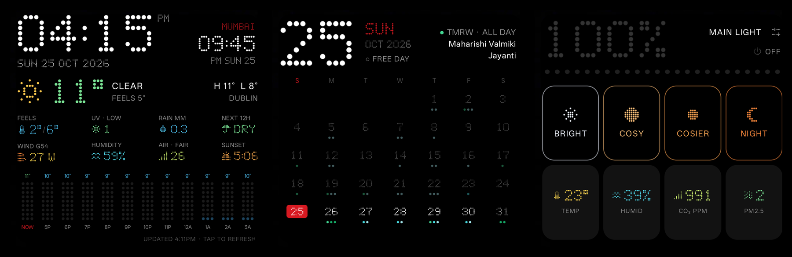

# Custom apps

Small Android apps for a black, Nothing-style phone on Niagara Launcher.

| App | What it is |
|---|---|
| [dotboard](dotboard) | Dotboard: dot-matrix home-screen widgets: weather (local and Mumbai clocks, local weather, hourly rain, air quality, Met Éireann warnings), a month calendar with day and year overlays, and IKEA DIRIGERA light control with room sensors |
| [mono-lines](mono-lines) | Line-icon pack tinted to match the widget's palette (icons from [Arcticons](https://arcticons.com), CC BY-SA 4.0) |
| [link-router](link-router) | Default-browser stand-in that forwards links to your chosen browser, optionally in private mode, with a self-reverting "temporarily use Chrome" switch |

Each folder is its own Gradle project with a wrapper; see its README to build and install.
