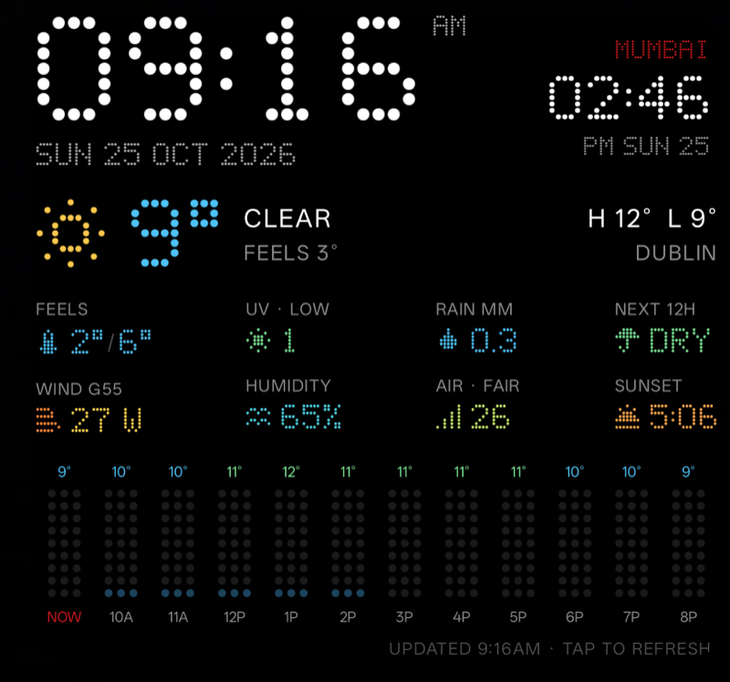

# Weather Widget

A dark, dot-matrix Android home-screen widget: your time, Mumbai time, and today's local weather at a glance.



## What it shows

- **Clocks**: local time and date (follows the phone's timezone) plus Mumbai time
- **Now**: temperature (coloured from icy blue to hot orange), conditions with a coloured icon, feels-like, high / low and your city
- **Today**, as a 4 × 2 grid:
  - feels-like low / high, UV index (WHO colours), total rain, next rainy hour (or *DRY*)
  - wind speed and direction with gusts, humidity, air quality (European AQI), next sunrise or sunset
- **Next 12 hours**: temperature along the top and chance of rain as dot columns, deeper blue when rain is likelier
- **Weather warnings**: Met Éireann warnings for the county you're in, coloured by level; hidden when there are none so the chart gets the space

Tap the widget to refresh. The forecast also refreshes every 30 minutes; the clocks redraw every minute.

## Month calendar widget

A second widget in the same app, in the same dot-matrix style:

- **Poster**: today's date as giant dot digits, the weekday in red, the month, today's event count, and the next event in the coming week
- **Month grid**: weeks start on Sunday; today on a red block, past days dimmed, up to three event dots per day in their calendar colours. Rows stretch to fill the widget
- **Day view**: tap any day for an overlay with that day's events (tap one to open it, **+ New event** to add one), a week strip to jump between days, and swipe left/right for the next/previous day
- **Year view**: tap the big date (or **Year** in the day view) for all twelve months with event days marked; tap a day to open it

It reads your calendars (READ_CALENDAR, granted from the setup screen) and redraws just after midnight.

## IKEA home widget

A third widget for an IKEA DIRIGERA hub, talking to it directly over your home Wi-Fi (no IKEA cloud):

- **Light**: brightness in big dot digits (dim when off), a dot level meter, and the current preset. Tap to turn it on or off; the tune icon opens an overlay with live brightness and warmth sliders
- **Presets**: BRIGHT (full, cool white), COSY (60%), COSIER (30%) and NIGHT (8%), all warm white; the active one is solid
- **Readings**: temperature, humidity, CO₂ and PM2.5 from IKEA sensors (e.g. TIMMERFLOTTE, ALPSTUGA), colour-coded, with an "open a window" nudge when CO₂ passes 1000 ppm
- Taps update the widget instantly, then confirm once the hub reports the new state

**Pairing**: tap the widget, then *Find my hub*; it finds the hub on the network and asks you to press the hub's action button. The app keeps the hub's certificate from that moment and only talks to a hub presenting the same one.

The hub's local API isn't officially documented by IKEA; the pairing flow follows the community [dirigera](https://github.com/Leggin/dirigera) library, and a firmware update could change it.

## Data

- Forecast and air quality: [Open-Meteo](https://open-meteo.com) (free, no API key)
- Warnings: [Met Éireann open data](https://www.met.ie/about-us/specialised-services/open-data), Republic of Ireland only. The badge only appears when there's an active warning (or the check failed), so elsewhere it stays hidden.
- Location: approximate (city-level) only, rounded to ~1 km before it's sent to Open-Meteo. Without location permission it uses the last known place, or Dublin.

## Build and install

Needs JDK 17+ and the Android SDK (API 36). Point `local.properties` at your SDK:

```
sdk.dir=/path/to/Android/sdk
```

Then, with a phone connected over USB debugging:

```
./gradlew installDebug
```

Open the **Weather Widget** app once to grant location (choose *Approximate*, then *Allow all the time* so it can update in the background) and calendar access, then add the widgets from your launcher's widget picker. It's sized 4×4 by default and can be resized.

## Notes

- Custom fonts don't work in Android widgets, so the dot-matrix digits, letters and icons are drawn as bitmaps from small 5×7 grids in `WeatherWidget.java`.
- The clocks are redrawn by an exact alarm each minute. Some Android skins (e.g. OxygenOS) batch these, so the minute can change up to ~30 s late.
